

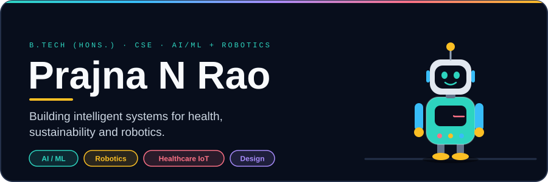

📬 [Email](mailto:prajna23rao@gmail.com) &nbsp;·&nbsp; 💼 [LinkedIn](https://www.linkedin.com/in/prajna-n-rao-84a4b3333) &nbsp;·&nbsp; 📍 Bengaluru, India

 


 

##  Projects at a glance

Each project in one picture. The full code and write-ups live in the repositories.

<table>
<tr>
<td width="50%" valign="top">
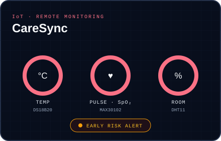
<b>CareSync</b>: 24/7 remote vitals from three sensors, streamed to a live dashboard that warns early.
</td>
<td width="50%" valign="top">
<b><a href="https://github.com/prajnanrao/AyurMitraAI">AyurMitraAI</a></b>: ANN + LSTM predicts a condition from symptoms and lifestyle, then suggests herbs, diet and yoga, with SHAP explanations.
</td>
</tr>
<tr>
<td valign="top">
<b><a href="https://github.com/prajnanrao/AyurMitra-Android-App">AyurMitra App</a></b>: Android wellness app with Dosha analysis, herb library, yoga modules and a health score.
</td>
<td valign="top">
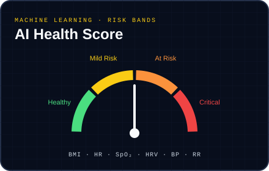
<b>AI Health Score</b>: turns BMI, HR, SpO₂, HRV, BP and RR into one of four risk bands.
</td>
</tr>
<tr>
<td valign="top">
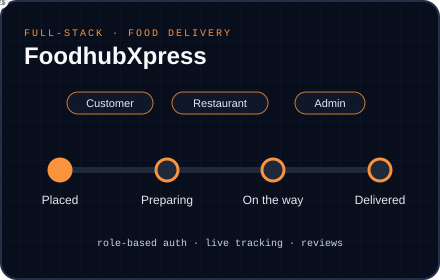
<b>FoodhubXpress</b>: full-stack food delivery with role-based access, live order tracking and an admin dashboard.
</td>
<td valign="top">
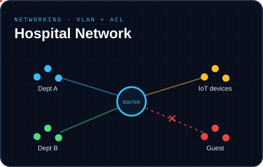
<b>Hospital Network</b>: VLAN-segmented hospital network where departments talk through a router and guests are blocked by ACLs.
</td>
</tr>
<tr>
<td valign="top">
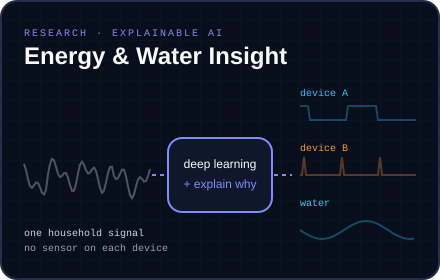
<b>Research internship</b>: explainable AI that separates household energy and water use from a single signal, without a sensor on every device.
</td>
<td valign="top">
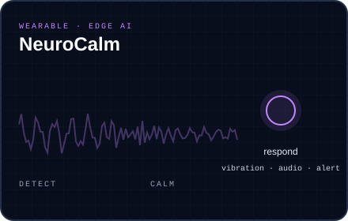
<b>NeuroCalm</b>: a wearable that spots a panic attack from heart rate, SpO₂ and motion, then calms the wearer with vibration and audio. <i>Co-authored paper.</i>
</td>
</tr>
</table>

 

## 🤖 Robotics & Automation

I enjoy learning across disciplines, from AI and computing to robotics, automation, design and the engineering ideas that connect them.

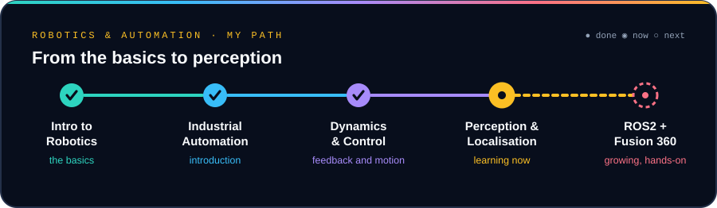

<table>
<tr>
<td width="50%" valign="top">
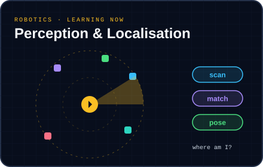
<b>Perception & Localisation</b>: learning how a robot scans its surroundings and works out where it is. <i>Studying now.</i>
</td>
<td width="50%" valign="top">
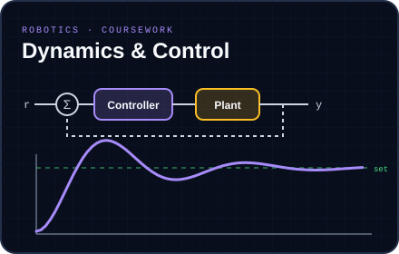
<b>Dynamics & Control</b>: feedback loops, and how a system settles on its target.
</td>
</tr>
</table>

 

## 🤖 Robotics & Automation

My minor started with the basics and is now moving into how robots sense and locate themselves.

<table>
<tr>
<td width="50%" valign="top">

<b>Perception & Localisation</b>: learning how a robot scans its surroundings and works out where it is. <i>Studying now.</i>
</td>
<td width="50%" valign="top">

<b>Dynamics & Control</b>: feedback loops, and how a system settles on its target.
</td>
</tr>
</table>

 

## 🛠️ Making & design

<table>
<tr>
<td width="50%" valign="top">
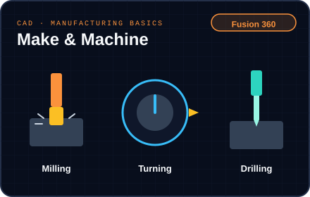
<b>Make & Machine</b>: designing in Fusion 360 and learning the basics of milling, turning and drilling.
</td>
<td width="50%" valign="top">
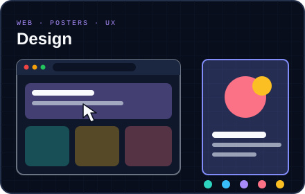
<b>Design</b>: websites, posters and UX, which is where I enjoy combining design with AI.
</td>
</tr>
</table>

 

## 🧰 Skills

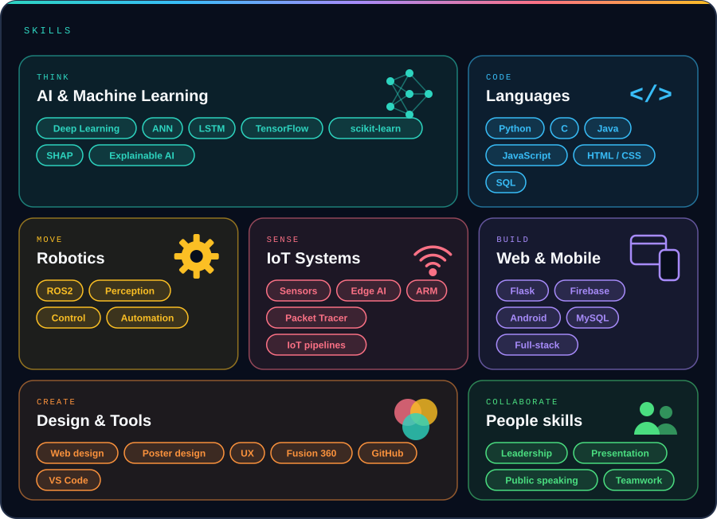

 

## 🎓 Learning

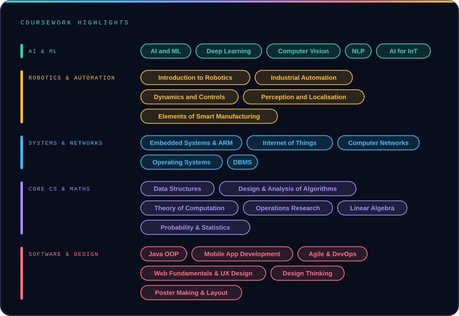
  
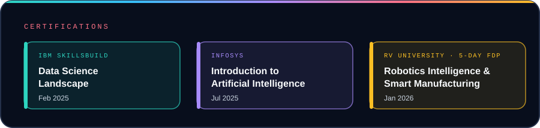

 

*Open to research collaborations and interesting problems in AI, healthcare and robotics.*

